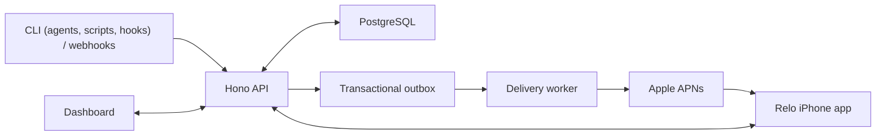
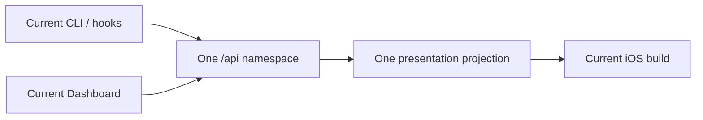

# Relo architecture

Relo is a modular monolith with one database and one asynchronous delivery worker. The architecture
is intentionally boring: one API process owns product decisions, PostgreSQL owns truth, and the
worker turns committed outbox jobs into APNs requests. Two ideas organize the product on top of
that: three separate sources of state ([State model](#state-model)) and a CLI that does the heavy
lifting on the computer ([The edge and the server](#the-edge-and-the-server)).

## System boundary

## Responsibilities

| Boundary | Owns | Must not own |
| --- | --- | --- |
| `apps/server/src/app.ts`, route modules | Authentication adapters, validation, orchestration, HTTP projection | APNs socket behavior or client UI rules |
| Domain modules such as `activities.ts`, `services.ts` | Canonical state transitions and transaction boundaries | Provider retries or HTML rendering |
| PostgreSQL migrations and stores | Durable state, constraints, idempotency, outbox jobs | Presentation policy decisions |
| `worker.ts`, `apns-runtime.ts` | Job leases, provider attempts, retry classification | Canonical notification/interaction outcomes |
| `apns-provider-cleanroom.ts` | HTTP/2, signing, Apple response handling | Database/domain policy |
| `apps/dashboard` | Owner-facing control surface; displays derived state | Canonical business rules, policy |
| `packages/cli` | Authenticated commands and stable process exits; the edge: each session's local declared copy, the per-session phase state machine, sealing, the durable outbox, hook adapters | Time-based policy, aggregation across producers, delivery, hidden server fallback |
| `apps/server/src/works`, `agent-sessions.ts`, `harness-credentials.ts` | Declared work records per producer type, observed session snapshots, harness credentials | Interpreting raw hook events; reading sealed text |
| `apps/server/src/derive` | The one function that turns declared work, observed evidence and time into owner state (`GET /api/now`) | Storing derived state as truth |
| `skills/relo-notifications` | Agent workflow guidance: keep one work current with `relo work`, ask on it, notify sparingly | Credentials, server authority, or UI composition |
| `apps/ios` | Native UI, local cache, ActivityKit, receipts, replies | Server policy, timers or phase rules, or inferred delivery truth |
| `packages/contracts` | Shared schemas and limits | Runtime I/O or persistence |

## State model

Relo state has three sources. Each writes only its own fields, and they meet only in the derivation
([ADR 0007](adr/0007-presence-messages-work-separation.md),
[ADR 0008](adr/0008-relo-design-framework.md)). Tests pin this
(`apps/server/src/work-model-invariants.test.ts`, the CLI hook invariant tests).

| Source | Sets | Written by | Never |
| --- | --- | --- | --- |
| **Declared**: a producer's intent | goal, plan and steps, status text, question, outcome, and the producer's own lifecycle choices (pause, resume, finish) | `relo` commands or the API, from the producer that holds the work | inferred by the server, set by hooks |
| **Observed**: sessions | the session's phase (open, working, waiting, stopped, ended), tool running since, last seen | optional hooks, through the CLI's phase snapshots, and the session's own `relo` commands | touching declared state: work, plans, questions |
| **Derived**: policy | attention (needs you), freshness, visibility (Lock Screen, Now, History), urgency, the Sessions view | one server function, `derive()`, from declared and observed state and time | stored as truth, duplicated in a client, written by a producer or a hook |

The owner's surfaces (iPhone, Lock Screen, Dynamic Island, Watch, Dashboard) display derived state
and keep no timers, windows or phase rules. They read `GET /api/now` and refetch at the `refreshAt`
it returns.

### Vocabulary

| Term | Meaning |
| --- | --- |
| **Session** | One agent conversation (a Claude Code session, a Codex thread). It has a name, a place (project and computer) and an observed state: working, waiting on you, idle or ended. The unit of ownership and isolation, identified internally by a session key. |
| **Work** | One declared goal of a producer: a versioned plan of named steps with stable ids, a status, an outcome. An agent session has at most one open work; others are parked. |
| **Card** | The Live Activity that shows a work. |
| **Agent** | Only a source label on a session, never an entity of its own. |

Subagents roll up into their session. A session running subagents is simply working; Relo never
reports individual subagents, and a subagent never writes its session's declared state.

### Producer types

Each type is its own module with its own identity, surface, validation, routes and policy. Shared
code is limited to identical primitives: the content filter, idempotency, sealing and the constants.

| Type | Identity | Declares through | Liveness evidence |
| --- | --- | --- | --- |
| Agent session | the harness's session id, read by the CLI | `relo work`, `relo state`, `/api/session/works` | its own writes, plus hooks when enabled |
| Script | login plus a producer key | `relo work --producer`, `/api/producers/{key}/works` | its writes and a lease it renews |
| App or service | login with scopes, or a service secret | the HTTP API, `/hooks/{secret}/works` | its writes and a lease |
| Harness hooks | a harness credential (scope `presence:write` only) | nothing: observed snapshots only | is the observation |

Records carry their producer type and that type's identity, and `derive()` reads each type's own
evidence. What a session owns is visible only to that session; the CLI identifies the caller from
the harness, never from the agent. All-sessions views belong to the owner.

### Derivation

`derive()` (`apps/server/src/derive`) returns one owner state per work, and visibility, urgency and
relevance come from one table by state, evaluated in a fixed order. Four constants drive it:

| Constant | Value | Used for |
| --- | --- | --- |
| `T_fresh` | 20 minutes | a card is stale after it; "your turn" on the Lock Screen; reminder threshold |
| `T_retire` | 60 minutes | a quiet card leaves the Lock Screen; a declared wait ends its protection |
| `T_done` | 15 minutes | a finished card lingers; an ended session is hidden |
| `T_history` | 8 hours | "left unfinished"; the "since you looked" window; the ActivityKit card limit |

Derived safeguards keep idle, stopped, stale or broken items off the owner's screens, and change
only what is shown, never the declared or observed state. A stale card is shown dimmed on the Lock
Screen and folded everywhere else, never as running. Without hooks the safeguards rely on declared
timestamps alone. Observed facts (turn running, session ended, tool running) sharpen the judgement
when hooks are on.

### Hooks are optional

Everything works without hooks. With them, the CLI also knows when a session is working quietly,
waiting on the owner or stopped, reminds the agent of an unrefreshed or unfinished work, and restores
its memory of the work after compaction. Hooks never change a work, plan or question. See
[HOOKS-AND-HARNESSES.md](HOOKS-AND-HARNESSES.md).

## The edge and the server

Agents, hooks and scripts on a computer talk to Relo only through the `relo` CLI, which does the
heavy lifting. The server does only what needs an always-on, account-wide process and never
interprets raw activity. Remote services calling the HTTP API follow the same rule: send changes,
not streams.

| Responsibility | CLI (edge) | Server |
| --- | --- | --- |
| Declared working copy (plan, step ids, labels, version, pending question) | owns it in a per-session state file, rebuilt from the server on a miss | stores the authoritative record |
| Plan rules, content filter, real-words rule | enforces before sending | re-checks structure only (it cannot read sealed text) |
| Encryption | seals and opens | never reads content |
| Reply to the agent (echo, what the owner sees, next command, refusals) | renders | n/a |
| Observed session state | runs a local state machine per session from canonical events; subagents roll up locally | stores the last phase and its timestamp per session |
| Network | sends only changes: declared writes and phase transitions, plus a coarse heartbeat while working, through a durable ordered outbox with idempotency keys | accepts, de-duplicates, stores |
| Reminders and memory restore | local, no network | n/a |
| Time-based policy (stale, retire, left unfinished, 8 hours, waking phones) | n/a | owns it: it is the only process awake when the computer sleeps |
| Aggregation across computers, sessions, scripts and services (Now, ranking, at most 3 cards) | n/a | owns it |
| Delivery (APNs, outbox, callbacks, answer feed) | n/a | owns it |
| Authority (credentials and scopes, isolation, idempotency) | presents its credential | enforces |

Consequences: hooks return immediately and the harness never waits on the network; prompts, tool
names and per-tool events never leave the computer; offline work is queued, not lost. An outbox
entry names the server it was queued for and is never sent to another. `derive()` stays one server
function with small, meaningful inputs (declared state, the last observed phase and time, leases)
instead of an event stream.

The server accepts observed snapshots only on `POST /api/agent-sessions/observed`, only from a
harness credential, and a harness credential is refused on every other route.

## Storage blocks

PostgreSQL stores accounts, credentials, devices, services, notification events, interactions, Live
Activities, normalized context resources, delivery jobs, provider attempts, and phone evidence.
Writes that require delivery commit domain state and outbox work together. The worker leases jobs;
it never reconstructs missing domain state from an APNs payload.

The iPhone cache is a bounded convenience layer scoped to the authenticated account. It is not a
second source of truth. Keychain stores device/session material; ActivityKit owns system Live
Activity instances.

Ordinary notification links follow the same ownership path. The request contract accepts one HTTPS
`destinationUrl`, PostgreSQL stores it with the canonical event, APNs receives it as inert custom
data, and Dashboard/iOS expose it through a validated external-link affordance. Neither client nor
the server fetches the destination as part of notification delivery.

## Main flows

### Phone connection

1. In the Relo app the only setup action is **Sign in**. It opens the server's web sign-in in the
   browser, bound to this installation.
2. The owner approves on the server's `/mobile/sign-in` page (a signed-out browser goes to
   `/sign-in?next=…` first) and returns to the app. The server stores only a hash of the one-time
   code, which expires quickly.
3. The API atomically consumes the code for that one installation, creates an account session, and
   rejects expiry or consumption by another installation.
4. iOS persists the origin, registers its device through the existing authenticated idempotent
   registration operation, and uses the resulting device credential for Inbox work.

The returned code is an authentication handoff, not a container for a password, reusable browser
session, device credential, or APNs token.

### User administration

`account_identities` maps owner and member users to the single self-hosted principal. Only an owner
may create members, disable or enable them, revoke sessions/devices, or set a replacement password.
Self-service password change remains a separate Better Auth operation that requires the current
password. Devices record the user that registered them so revocation has an exact boundary.

### Notification or interaction

1. A credential or webhook submits a validated request.
2. The API commits the canonical event, targets, interaction state if any, and delivery jobs.
3. The worker leases each job and records provider outcomes.
4. The exact device may later record received, opened, or responded.
5. The first valid authenticated response wins; ambiguous outcomes fail closed.

A notice an agent session sends while its work is open folds into that work: it is recorded on the
work with no delivery job of its own (the finish outcome is the notification). A card asks one
question at a time: asking on a card that is already waiting is refused (`question_pending`), and a
card update that asks a new question cancels the pending one. A question that expired unanswered
stays visible as missed until the owner opens it or dismisses it from a phone; a dismissed question
refuses a late answer.

### Live Activity

A card is the projection of a work: the server starts, updates and ends it from the work's declared
state and the derivation, and an agent never addresses a card by id. The server owns lifecycle identity, generation, sequence, presentation recipe, and durable commands.
iOS renders supported native primitives and reports application results. Server commit, APNs
acceptance, ActivityKit invocation, and device receipt remain separate facts.

### One current product contract

Relo is pre-release and deliberately has no product-protocol compatibility matrix:

- Requests use `/api`; `/v1` is not an alias.
- A presentation has no version or fallback field and is projected once for every eligible device.
- A phone registers after browser sign-in; pairing-code and QR routes do not exist.
- iOS accepts only the current local-storage envelope and discards retired stores.
- A coordinated contract change clears disposable activity/device state and requires the app to
  rebuild and sign in again.

Release numbers, PostgreSQL migration filenames, credential revision counters, and Activity
generation/sequence remain because they identify artifacts, order schema changes, revoke secrets,
or enforce event ordering. None of them chooses an older product behavior.

OpenCode's externally named V1 and V2 permission interfaces are adapters for two different
upstream APIs. They are not Relo protocol versions and do not select an older Relo contract.

## Clean development baseline

Relo does not carry the former product identity as a compatibility protocol. Database roles,
channels, cryptographic domains, APNs custom data, notification categories, ActivityKit types,
bundle identifiers, package coordinates, configuration keys, and runtime paths all use Relo.

Major identity or storage cutovers may intentionally invalidate a development database, credentials,
device registrations, queued jobs, and installed iOS builds. Those cutovers require an explicit
release note, a fresh database, and clients signing in again; they are not silent compatibility behavior.

## Known structural debt

- `app.ts`, `web.ts`, the CLI dispatcher, and iOS `AppModel` are larger than ideal.
- Route registration, operation logic, stores, and response projection are not consistently split.
- The CLI still hand-maintains parts of the API shape instead of consuming a generated client.
- Clean public-source install proof remains the primary adoption gap tracked in the roadmap.

Refactoring follows real feature seams. Relo does not need microservices, another evidence layer,
or a framework rewrite.
