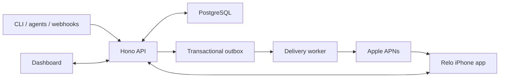
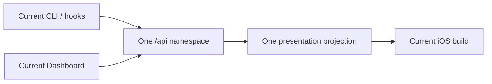

# Relo architecture

Relo is a modular monolith with one database and one asynchronous delivery worker. The architecture
is intentionally boring: one API process owns product decisions, PostgreSQL owns truth, and the
worker turns committed outbox jobs into APNs requests.

## System boundary

## Responsibilities

| Boundary | Owns | Must not own |
| --- | --- | --- |
| `apps/server/src/app.ts`, route modules | Authentication adapters, validation, orchestration, HTTP projection | APNs socket behavior or client UI rules |
| Domain modules such as `activities.ts`, `services.ts` | Canonical state transitions and transaction boundaries | Provider retries or HTML rendering |
| PostgreSQL migrations and stores | Durable state, constraints, idempotency, outbox jobs | Presentation policy decisions |
| `worker.ts`, `apns-runtime.ts` | Job leases, provider attempts, retry classification | Canonical notification/interaction outcomes |
| `apns-provider-cleanroom.ts` | HTTP/2, signing, Apple response handling | Database/domain policy |
| `apps/dashboard` | Owner-facing control surface | Canonical business rules |
| `packages/cli` | Authenticated commands and stable process exits | Parallel state machines or hidden server fallback |
| `skills/relo-notifications`, `packages/codex-notify` | Agent workflow guidance and Codex lifecycle adaptation | Credentials, server authority, or UI composition |
| `apps/ios` | Native UI, local cache, ActivityKit, receipts, replies | Server policy or inferred delivery truth |
| `packages/contracts` | Shared schemas and limits | Runtime I/O or persistence |

## Storage blocks

PostgreSQL stores accounts, credentials, devices, services, notification events, interactions, Live
Activities, normalized context resources, delivery jobs, provider attempts, and phone evidence.
Writes that require delivery commit domain state and outbox work together. The worker leases jobs;
it never reconstructs missing domain state from an APNs payload.

The iPhone cache is a bounded convenience layer scoped to the authenticated account. It is not a
second source of truth. Keychain stores device/session material; ActivityKit owns system Live
Activity instances.

Ordinary notification links follow the same ownership path. The request contract accepts one HTTPS
`destinationUrl`, PostgreSQL stores it with the canonical event, APNs receives it as inert custom
data, and Dashboard/iOS expose it through a validated external-link affordance. Neither client nor
the server fetches the destination as part of notification delivery.

## Main flows

### Phone connection

1. A signed-in Dashboard user creates a ten-minute connection grant from Connections → Connect
   iPhone. The server stores only its hash and returns the raw grant once inside a current QR
   document containing the canonical server origin.
2. The iOS login screen scans the document, validates its type, origin, and expiry, then
   asks the user to confirm the visible origin.
3. The API atomically consumes the grant for one installation, creates an account session, and
   rejects expiry, revocation, or consumption by another installation.
4. iOS persists the confirmed origin, registers its device through the existing authenticated
   idempotent registration operation, and uses the resulting device credential for Inbox work.

The QR is an authentication handoff, not a container for a password, reusable browser session,
device credential, or APNs token.

### User administration

`account_identities` maps owner and member users to the single self-hosted principal. Only an owner
may create members, disable or enable them, revoke sessions/devices, or set a replacement password.
Self-service password change remains a separate Better Auth operation that requires the current
password. Devices record the user that registered them so revocation has an exact boundary.

### Notification or interaction

1. A credential or webhook submits a validated request.
2. The API commits the canonical event, targets, interaction state if any, and delivery jobs.
3. The worker leases each job and records provider outcomes.
4. The exact device may later record received, opened, or responded.
5. The first valid authenticated response wins; ambiguous outcomes fail closed.

### Live Activity

The server owns lifecycle identity, generation, sequence, presentation recipe, and durable commands.
iOS renders supported native primitives and reports application results. Server commit, APNs
acceptance, ActivityKit invocation, and device receipt remain separate facts.

### One current product contract

Relo is pre-release and deliberately has no product-protocol compatibility matrix:

- Requests use `/api`; `/v1` is not an alias.
- A presentation has no version or fallback field and is projected once for every eligible device.
- A phone registers through a current account connection grant; pairing-code routes do not exist.
- iOS accepts only the current local-storage envelope and discards retired stores.
- A coordinated contract change clears disposable activity/device state and requires the app to
  rebuild and pair again.

Release numbers, PostgreSQL migration filenames, credential revision counters, and Activity
generation/sequence remain because they identify artifacts, order schema changes, revoke secrets,
or enforce event ordering. None of them chooses an older product behavior.

OpenCode's externally named V1 and V2 permission interfaces are adapters for two different
upstream APIs. They are not Relo protocol versions and do not select an older Relo contract.

## Clean development baseline

Relo does not carry the former product identity as a compatibility protocol. Database roles,
channels, cryptographic domains, APNs custom data, notification categories, ActivityKit types,
bundle identifiers, package coordinates, configuration keys, and runtime paths all use Relo.

Major identity or storage cutovers may intentionally invalidate a development database, credentials,
device registrations, queued jobs, and installed iOS builds. Those cutovers require an explicit
release note, a fresh database, and client re-pairing; they are not silent compatibility behavior.

## Known structural debt

- `app.ts`, `web.ts`, the CLI dispatcher, and iOS `AppModel` are larger than ideal.
- Route registration, operation logic, stores, and response projection are not consistently split.
- The CLI still hand-maintains parts of the API shape instead of consuming a generated client.
- Clean public-source install proof remains the primary adoption gap tracked in the roadmap.

Refactoring follows real feature seams. Relo does not need microservices, another evidence layer,
or a framework rewrite.
